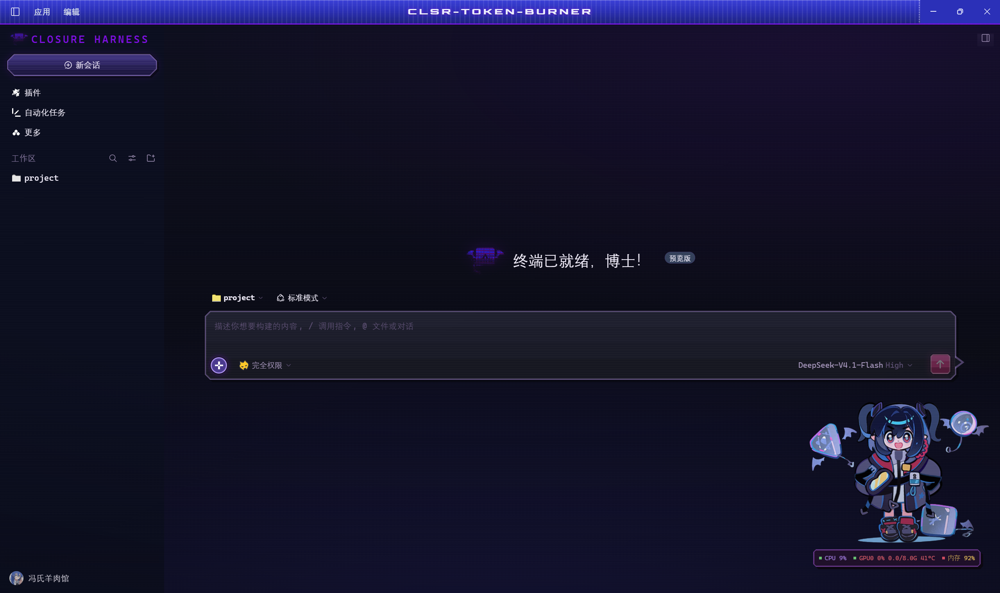
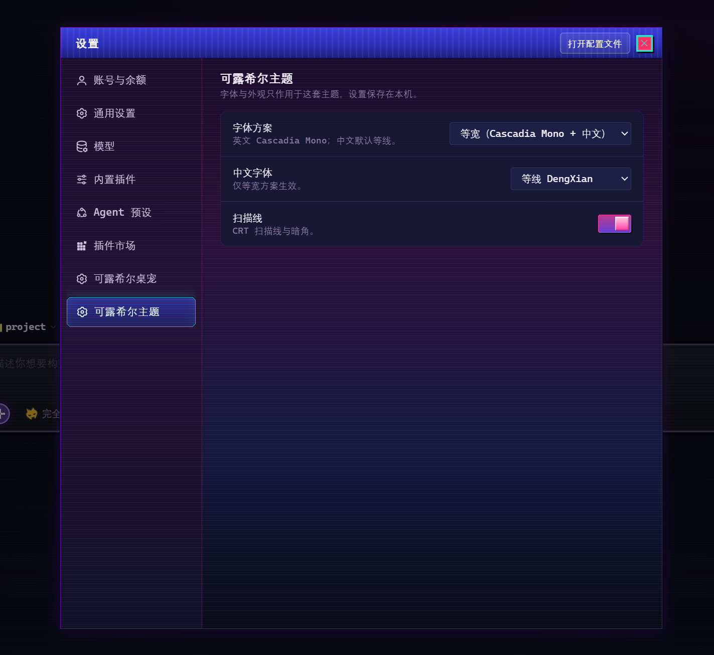
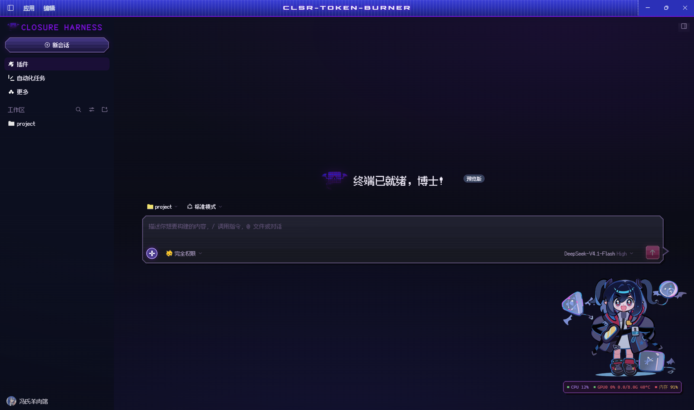

<div align="center">


<br />

[](LICENSE)
[](https://github.com/deepseek-ai/deepseek-harness)
[](#效果预览)
[](#字体方案)

</div>

适用于 DeepSeek Harness 的《明日方舟》可露希尔主题客户端皮肤——融合复古未来主义机能美学与 CRT 终端视觉，提供深/浅色暗调玻璃拟态配色、扫描线纹理与定制像素图标，并支持自由切换多套中英文字体方案。

> [!WARNING]
> 本仓库为个人二次创作主题皮肤，角色主题元素源自《明日方舟》相关设定；插件代码按 MIT 许可证提供，内置字体遵循各自开源协议（如 Fusion Pixel 12px 与 Orbitron 均为 SIL OFL 1.1），详见仓库内 `FONT-NOTICE.md` 与 `LICENSE-FONT`。

---

## 快速开始

### 1. 从仓库安装

在 **Plugins → Add plugin** 中填入仓库地址：

```text
[https://github.com/fengshiyangrouguan/dsh-closure-skin](https://github.com/fengshiyangrouguan/dsh-closure-skin)
```

或者手动编辑对应 profile 的 `package.json`，添加依赖并将插件名加入 `dsh.profile.bundles`：

```json
{
  "dependencies": {
    "dsh-closure-skin": "github:fengshiyangrouguan/dsh-closure-skin"
  },
  "dsh": {
    "profile": {
      "bundles": ["dsh-closure-skin"]
    }
  }
}
```

### 2. 本地开发安装

将依赖指向本地目录，同样需要加入 `dsh.profile.bundles`：

```json
{
  "dependencies": {
    "dsh-closure-skin": "link:<本地路径>/dsh-closure-skin"
  },
  "dsh": {
    "profile": {
      "bundles": ["dsh-closure-skin"]
    }
  }
}
```

> [!IMPORTANT]
> 首次安装或更新涉及字体路由的服务端部分后，请重启一次 DSH 以确保字体服务生效。

---

## 核心功能

### 视觉与界面表现

* **复古未来主义主题**：提供深色与浅色霓虹终端配色风格，搭配扫描线效果与暗色玻璃拟态，兼顾复古终端质感与界面可读性。
* **图标替换**：覆盖插件、自动化任务、更多、刷新、加载、文件夹、置顶、归档等高频界面图标，统一视觉语言。
* **可调主题选项**：在 **设置 → 可露希尔主题** 中可随时切换字体方案、中文字体与扫描线效果。

### 字体方案

* **默认组合**：英文使用 **Cascadia Mono**，中文使用 **DengXian（等线）**。
* **可选像素与标题字体**：支持切换至 **Fusion Pixel**（12px，作者 TakWolf，SIL OFL 1.1）或系统默认字体；顶栏标题字标采用 **Orbitron Black**（OFL）。

---

## 效果预览

- 页面效果预览


- 主题配置界面


- 另一种字体方案（**不想折磨自己的眼睛的话就不要使用！！**）

---

## 项目结构与构建

```text
├── cordis.patch.yml            # DSH bundle 入口配置
├── docs/
│   └── design.md               # 设置页视觉规范、层级与控件约定
├── lib/
│   ├── index.js                # 宿主侧入口，提供字体路由
│   ├── client.js               # 构建生成的客户端脚本（勿手改）
│   └── fonts/                  # Fusion Pixel 12px 与 Orbitron 字体文件
├── src/
│   ├── client.template.js      # 客户端界面模板
│   └── icons/                  # 像素图标素材
└── tools/
    ├── build-client.mjs          # 构建客户端脚本工具
    └── preview-settings.mjs      # 设置页渲染预览与校验脚本
```

### 本地构建与预览

修改 `src/client.template.js` 或 `src/icons/` 后，需重新生成客户端脚本（不要直接手改 `lib/client.js`）：

```sh
node tools/build-client.mjs
```

如需快速查看设置页渲染效果或做结构校验：

```sh
node tools/preview-settings.mjs <输出前缀>
node tools/preview-settings.mjs <输出前缀> --verify
```

> 发布或复制插件目录时，请连同构建产物 `lib/`（含 `lib/fonts/`）一起保留。

---

## 仓库趋势与贡献者

<div align="center">

[](https://star-history.com/#fengshiyangrouguan/dsh-closure-skin&Date)

<br />

<a href="https://github.com/fengshiyangrouguan/dsh-closure-skin/graphs/contributors">
  
</a>

</div>

### 参与贡献（All Contributors）

欢迎通过 Issue 或 Pull Request 提出建议、补充图标/样式或完善文档，常见贡献方向包括：

| 贡献类型 | 标识 | 说明 |
|---|---|---|
| 样式与代码 | 💻 | 主题样式调整、构建脚本与设置项优化 |
| 图标与视觉 | 🎨 | 图标补充、主题细节打磨 |
| 文档与说明 | 📖 | README 与设计规范文档完善 |
| 问题反馈 | 🐛 | 复现步骤清晰的样式异常或兼容性反馈 |

---

## 许可证

代码部分采用 [MIT License](LICENSE)；内置字体及衍生视觉素材的授权说明请参见 [`FONT-NOTICE.md`](FONT-NOTICE.md) 与 [`LICENSE-FONT`](LICENSE-FONT)。